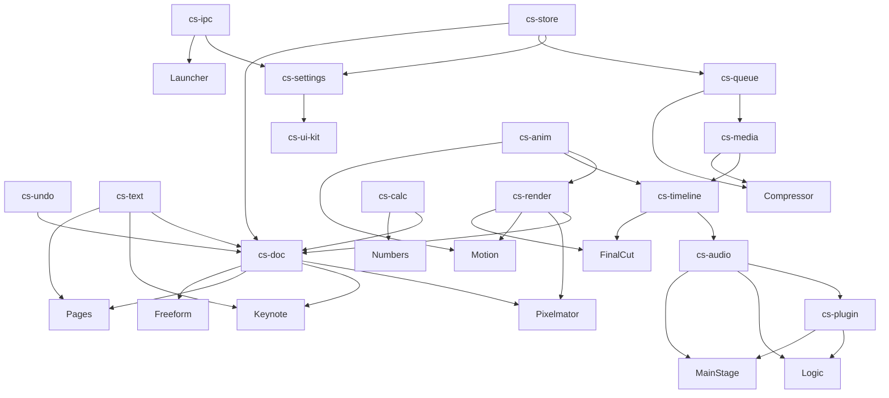

# Dependency graph

## App-to-app build dependency
Compressor → (none). Pixelmator → cs-render. Keynote/Pages/Freeform → cs-doc+cs-text. Numbers → cs-calc. Motion → cs-anim. Final Cut → cs-timeline + Motion-level render. Logic → cs-audio+cs-plugin. MainStage → Logic engines.
